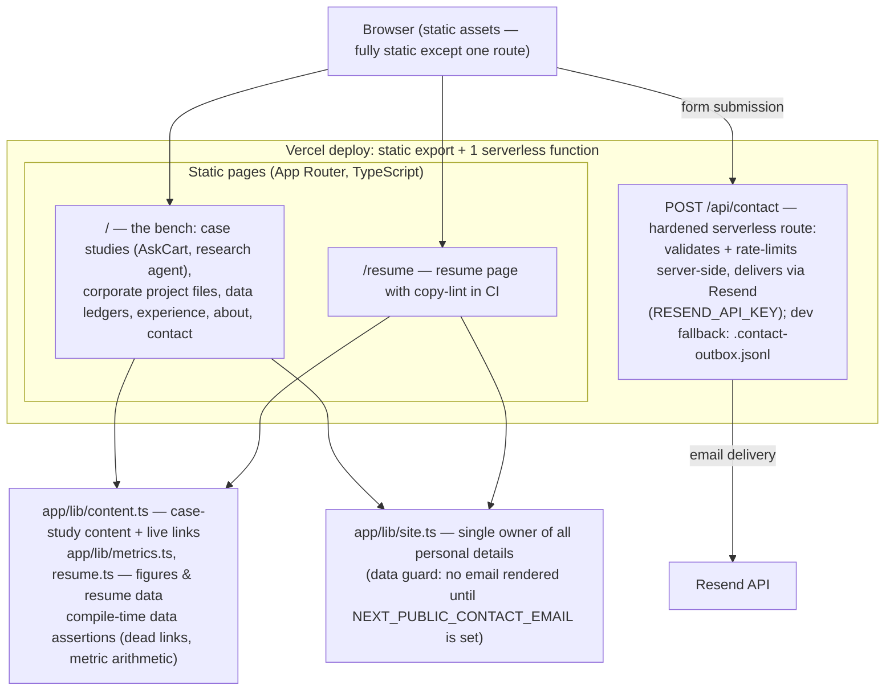

# Suparna Deshmukh · Portfolio

A PM's physical bench: paper, stamps, ledgers and a route manifest. One scrolling page — two case studies (AskCart, research agent), corporate project files, data ledgers, experience, about, contact — plus a `/resume` page. Next.js (App Router) + TypeScript + hand-rolled CSS: no UI kit, no animation libraries; motion is hand-rolled and gated behind `html.motion-ok` (see `UI-SPEC.md`). Fonts self-hosted (`next/font/local`) except DM Mono.

**Live:** not currently deployed to a public URL — runs locally (see below). *(An older static portfolio exists at suparna-portfolio.vercel.app; this Next.js site is the current one.)*

## System design



**Key decisions**

- **Static-first**: every page except the contact route is static — the site ships as static assets + one serverless function.
- **Data guard**: the site renders no personal email until `NEXT_PUBLIC_CONTACT_EMAIL` is set; all personal details live in `app/lib/site.ts`. Anything pending input ships hidden behind an empty-data guard — placeholder text on the live page is a defect.
- **Build discipline**: `npm run build` outputs to an isolated `.next-build` (dev keeps its own `.next`); `npm run check` = tsc + lint + resume copy lint, green in CI. Dev-server data assertions throw at compile time if a dead link or bad metric arithmetic is introduced.

## Run it

```bash
npm install
npm run dev        # dev server (the daemon uses port 3210)
npm run check      # tsc --noEmit + next lint + resume copy lint
npm run build      # production build into .next-build
npm run start      # serves the .next-build output
```

Env (`.env.example`): `NEXT_PUBLIC_SITE_URL` (canonical origin, set once a domain exists), `NEXT_PUBLIC_CONTACT_EMAIL` (public contact address — unset = no email shown), `RESEND_API_KEY` (contact-form delivery; dev fallback = local outbox file).

## Dev loop

```bash
python3 dev-daemon.py        # restarts `next dev` on :3210 if it dies
npx tsc --noEmit             # after every change
node scripts/shot-matrix.mjs http://localhost:3210/ out/ 1440x900light:home 390x844dark:home
```

Screenshots need a fresh Chrome profile per run. `scripts/check-resume.mjs` enforces resume copy rules; `scripts/build-resume-pdf.mjs` regenerates `public/Suparna-Deshmukh-Resume.pdf` from the same data as `/resume` — rerun whenever `app/lib/resume.ts` changes.

## Layout & rules

- `app/` — routes; `app/components/` — all UI; `app/lib/` — data and guards (`site.ts`, `content.ts`, `metrics.ts`, `resume.ts`, `hooks.ts`).
- `UI-SPEC.md` — the end-to-end spec (read first). `LICENSES.md` — font licenses (OFL 1.1). `docs/baseline.md` — pre-upgrade baseline metrics.
- House rules: code wins over docs (update `UI-SPEC.md` in the same commit as behavior change); no fabrication; preserve the identity (stationery/stamp language, Fraunces / Satoshi / DM Mono, pine green accent, section order, `html.motion-ok` gating); every animation needs a static first frame + reduced-motion fallback + off-screen pause, animating only `transform`/`opacity` (plus registered custom properties).
